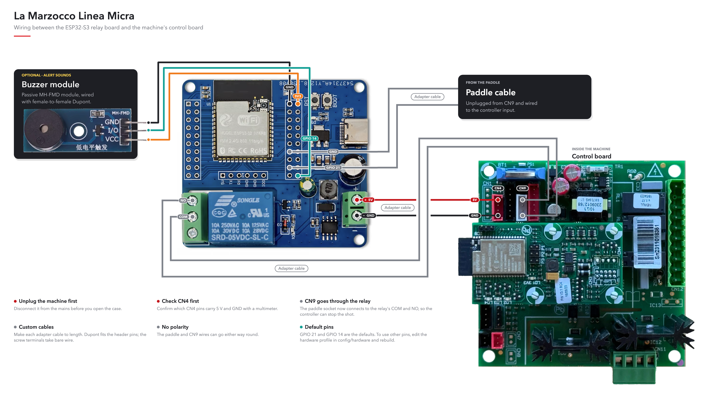

  <picture>
    <source media="(prefers-color-scheme: dark)" srcset="docs/images/banner-hero-dark.jpg">
    
  </picture>

# Open Brew by Weight

Open Brew by Weight adds brew-by-weight to an espresso machine: a Bluetooth
scale measures the drink, and an ESP32-S3 controller requests a stop near your
recipe's target weight. You keep using the machine's physical brew switch.

This repository provides firmware and hardware guidance for a DIY installation.
It is a work in progress, not a ready-to-install or certified kit. Development
started on the La Marzocco Linea Micra; other switch types have different wiring
and stop behavior.

> Before installation, read [Hardware](docs/HARDWARE.md). The relay must remain
> open on startup, reset, power loss, and safety failure. Machine-specific wiring
> instructions are incomplete. See the [Disclaimer](#disclaimer).

## Quickstart

**New here? Start with the [Quickstart](docs/QUICKSTART.md).** It takes the
reference build, an ESP32-S3 Relay X1 controller on a La Marzocco Linea Micra,
from a shopping list to your first shot by weight in six steps:

1. [Get the parts](docs/QUICKSTART.md#1-get-the-parts)
2. [Build and install the firmware](docs/QUICKSTART.md#2-build-and-install-the-firmware)
3. [Connect it to your Wi-Fi](docs/QUICKSTART.md#3-connect-it-to-your-wi-fi)
4. [Print the enclosure](docs/QUICKSTART.md#4-print-the-enclosure)
5. [Wire it into the Micra](docs/QUICKSTART.md#5-wire-it-into-the-micra)
6. [Pull the first shot](docs/QUICKSTART.md#6-pull-the-first-shot)

## Start here

| I want to… | Read |
| --- | --- |
| Go from parts to the first shot on a Linea Micra | [Quickstart](docs/QUICKSTART.md) |
| Check whether my equipment fits | [Requirements](#requirements) and [machine types](#machine-types) |
| Prepare hardware and firmware | [Hardware](docs/HARDWARE.md) → [Build and USB installation](docs/BUILD.md) |
| Choose a controller and machine build | [Hardware and machine build profiles](docs/BUILD_PROFILES.md) |
| Connect and make the first shot | [First setup and daily use](docs/GETTING_STARTED.md) |
| Change how brewing works | [Features and settings](#main-features) |
| Integrate Open Brew by Weight with Home Assistant | [Home Assistant setup](docs/features/home-assistant.md) |
| Understand an unexpected result | [Troubleshooting](docs/FAQ.md) |
| Update or recover the controller | [OTA](docs/features/ota.md) / [Recovery](docs/EMERGENCY_RECOVERY.md) |
| Develop or contribute | [Contributing](CONTRIBUTING.md) |
| Understand the test gates | [Testing and validation](#testing-and-validation) |
| Look up a technical term | [Technical glossary](#technical-glossary) |
| Find a specific reference | [Documentation index](docs/README.md) |

## Requirements

- **Board:** the current built-in hardware profiles use an ESP32-S3 N16R8
  (16 MB flash / 8 MB PSRAM). The [development relay board](docs/HARDWARE.md#development-board)
  has a specific GPIO map; another board needs a complete reviewed profile.
- **Scale:** a supported Bluetooth model. Bookoo Themis Mini/Ultra were the
  primary development scales. Check the [model and capability table](libraries/EspressoScaleBLE/README.md#scale-compatibility);
  implemented protocols are not all equally tested.
- **Machine:** a compatible activation circuit connected only to isolated relay
  contacts, plus a physical switch input appropriate to the selected build.
- **Installation skills:** identify and verify your machine's electrical
  connections, build the firmware, and test the installation on a bench.

The controller sits inside the machine in a
[printable enclosure](docs/HARDWARE.md#3d-printable-enclosure), included in
standard and thick versions. Print it in PETG or a more heat-resistant
material, never PLA.
Classic ESP32, boards without PSRAM, and Timemore scales are outside the current
support scope.

## How it works

The controller reads your brew switch separately from the machine's activation
circuit. It can therefore interpret your gesture and stop brewing according to
the scale, recipe guards, or time limits.

On paddle machines, the relay remains closed while brewing and opens to stop.
On momentary machines, it copies button presses and sends a pulse to request a
stop. **Opening that relay alone does not necessarily stop a momentary machine.**
See the distinctions below before choosing a build.

## Machine types

Prefer a named [hardware and machine build profile](docs/BUILD_PROFILES.md).
The selected machine profile resolves the corresponding compile-time type; it
is not a Web UI setting.

| Build | Value | How the controller knows the group is running |
| --- | ---: | --- |
| [Paddle / latch](docs/settings/paddle.md) | 0, default | Follows the maintained brew contact. Developed first for the Linea Micra. |
| [Momentary](docs/settings/momentary.md) | 1 | Infers flow from scale readings. Without confirmed flow, an automatic stop pulse may not be sent. |
| [Momentary + reed](docs/settings/momentary.md) | 2 | Uses an additional reed/hall input to observe the machine state. Preferred for momentary installations. |

Support for a switch model is not certification of a particular espresso
machine. The firmware's 60 s relay limit and the ability to stop water flow
are different on momentary machines; read the [stop limitations](docs/settings/momentary.md#stopping-and-time-limits).

This illustration shows how the Micra was wired during development: the paddle
cable, the machine's CN9 and CN4 connectors, and the optional buzzer. It is a
reference, not a replacement for checking your own machine; verify the actual
machine circuit and follow the [hardware safety guidance](docs/HARDWARE.md) before installation.

## Main features

| Need | Feature |
| --- | --- |
| Stop near a recipe weight | [Brew by weight](docs/features/brew-by-weight.md), with learned drip compensation |
| Use different recipes | [Presets](docs/features/presets.md), including factory Single and Double in Adaptive and Fixed versions |
| Integrate with a Linea Micra | [La Marzocco Cloud](docs/settings/linea-micra.md) reads and sets preset brew-boiler temperatures and recognizes when the paddle is waking the machine instead of starting a brew |
| Place the cup after starting | [Tare and retare](docs/features/tare-retare.md) |
| Handle cup removal or bumps | [Cup protection](docs/features/cup-protection.md) |
| Handle unexpectedly fast or slow shots | [Fast and slow shots](docs/features/fast-and-slow-shots.md) |
| Limit a shot after scale loss | [Scale-loss backup](docs/features/auto-to-manual.md) |
| Rinse with a switch gesture | [Quick rinse](docs/settings/quick-rinse.md), with a machine-profile default |
| Hear local feedback | [Alerts](docs/alerts.md), subject to scale/buzzer capabilities |
| Review results | [Shot history and statistics](docs/features/shot-history.md) |
| Integrate with Home Assistant | [Home Assistant](docs/features/home-assistant.md), with the integration in [its own repository](https://github.com/Cheerpipe/ha-open-brew-by-weight) |
| Update safely over Wi-Fi | [Dual-slot OTA](docs/features/ota.md), with automatic rollback |
| Send events to another local receiver | [Local HTTP webhooks](docs/features/webhooks.md) |

## Main settings

Recipe settings are saved with each preset in **Settings → Presets**. Everything
under **Settings → Shared settings** applies to every preset.
[Presets](docs/features/presets.md) explains what is saved and what a change
made on Home affects.

The [documentation index](docs/README.md#settings) links each settings group.
Defaults are starting points; on the Adaptive presets, fast shots can
intentionally finish a little above the target and slow shots a little below it.

### Brew by weight: drip and learning speed

Each shot stops toward `cut line − drip`, where the drip is the
**Expected drip weight after the shot stops**. After an eligible shot, the drip
moves by a fraction, the learning speed α, of that shot's error:
`next drip = clamp(drip + α × (final − cut line), 0, 5)`.
For example, with a 36 g cut line, final weight 36.20 g and drip 1.50 g:

| Current α | Next drip |
| --- | --- |
| 0.10 | 1.52 g |
| 0.30 | 1.56 g |
| 0.60 | 1.62 g |

A larger α responds faster to changes but also follows individual-shot noise
more strongly. A smaller α smooths that noise but adapts more slowly. An
underweight result reduces the drip so the next cutoff occurs later.
α learns between shots; it does not filter live scale readings or guarantee
better accuracy on a particular machine.

**Set drip** puts a new drip in use from the next shot and starts a quick
start: if the next three eligible shots agree within 0.4 g, the drip moves
straight to the middle one. **Set learning speed** applies α per preset, from
0.01 to 1.00 in steps of 0.01 (initially 0.30), and keeps the drip. Automatic
learning may subsequently choose 0.10, 0.30, 0.50 or 1.00; a custom α remains
active until a candidate earns a switch. See [BBW learning](docs/features/brew-by-weight.md#cutoff-behavior-and-learning)
for eligibility, comparison windows and persistence.

## First connection

After installation, follow
[First setup and daily use](docs/GETTING_STARTED.md). It covers connecting to the
controller's access point, opening the Web UI, joining home Wi-Fi, selecting a
scale, and making the first shot. Once the controller has joined your home
Wi-Fi, reach the Web UI at `openbrewbyweight.local`. Factory network details
are in [AP → First connection](docs/settings/ap.md#first-connection).

## Admin

Home and Settings use a browser claim; privileged actions also require Admin
unlock with the device password. These are separate controls:
[Web access](docs/GETTING_STARTED.md#web-access) explains both.

## Technical features

- [OTA updates](docs/features/ota.md) use an inactive firmware slot and boot
  verification. A bootable previous image is required for rollback.
- [Emergency recovery](docs/EMERGENCY_RECOVERY.md) restores access or resets
  settings using the physical switch.
- [Build and script reference](docs/SCRIPTS.md) covers supported ESP-IDF tooling.
- [Hardware and machine build profiles](docs/BUILD_PROFILES.md) defines the
  complete JSON profile, compatibility, override, and artifact contracts.

Remote start and rinse are **disabled by default**. A deliberate development
build can enable them; they are not part of the default operating workflow.
Remote Stop still requires Admin unlock. MQTT and persistent remote-control
integrations are outside the project goals. The Web UI provides status and
shot summaries, not a guaranteed real-time telemetry stream.

## Documentation

Use the [complete index](docs/README.md) for user guides, settings, architecture,
validation, and library integration. Read only the page needed for your task;
parameter tables and protocol contracts have one canonical home.

### Testing and validation

A **gate** is the set of checks that a change must pass before it can be accepted.
The project first classifies the changed files by risk, then runs the matching
gate. Higher levels include the lower-level checks, so a safety-critical change
receives much more scrutiny than a wording correction. The authoritative rules
and exact commands are in [Validation gates](VALIDATION.md).

| Level | What it is for | What it checks | When it runs |
| --- | --- | --- | --- |
| R0 | Non-critical documentation and repository metadata | Documentation contracts, local links, headings, images, and known paths | For documentation-only changes and as the base of every higher gate |
| R1 | Web UI, tests, developer tooling, and isolated logic | R0 plus the normal host tests and any focused checks or generated assets relevant to the change | While developing these areas and before submitting the finished change |
| R2 | BLE, networking, saved data, OTA, and build changes | Full host coverage, ASan/UBSan, TSAN, architecture rules, Web contracts, and every built-in compatible profile pair | When a change can affect integration, concurrency, memory safety, or a firmware image |
| R3 | Relay and machine control, ISR, watchdog, boot, GPIO, partitions, remote control, or an unknown path | R2 plus Cppcheck on the changed code, a no-inlining compile of the reference pair, build variants, and the applicable HIL/manual evidence | Before accepting any safety-critical or not-yet-classified change |
| Release | A firmware image intended for distribution or installation | The complete automated analysis plus resource budgets, applicable soak tests, HIL, and the manual test plan | For a release candidate; a passing automated R3 run alone is not release approval |

**Host tests** run on the developer computer, without an ESP32 or
espresso machine. They are quick feedback for software behavior, but cannot prove
that real wiring, timing, radio conditions, or machine stopping are safe. The
focused profiles are:

| Profile | Purpose | When to use it |
| --- | --- | --- |
| `normal` | Runs the broad functional host suite without a sanitizer | During ordinary development and in every R1-or-higher gate |
| `asan` | Runs the host suite with ASan and UBSan to expose memory errors and undefined operations | For R2/R3 changes and when investigating crashes or suspicious memory behavior |
| `tsan` | Runs concurrent host scenarios with TSAN to find unsafe access to shared data | For R2/R3 changes and whenever task or thread ownership changes |
| `web` | Verifies generated Web UI assets and browser-facing contracts | After changing the Web UI, its source assets, or asset generation |
| `ble` | Focuses the normal host suite on scale protocols and BLE radio behavior | After changing scale communication or BLE protocols |
| `ota` | Exercises OTA host logic plus command-line and Web resilience cases | After changing firmware-update behavior or its interfaces |
| `tooling` | Checks the developer command facade, risk classification, and validation contracts | After changing scripts or repository workflow rules |

Run these profiles locally with `./scripts/dev test <profile>` and the risk
gates with `./scripts/dev validate --risk R0..R3`; `./scripts/dev classify`
determines the gate required for the changed paths. These commands do not
flash a board, operate the relay, or replace required HIL and manual evidence.

### Technical glossary

| Term | Meaning in this project |
| --- | --- |
| α (alpha) | The learning speed used by adaptive EWMA. It controls how much the latest eligible shot changes the learned drip. |
| A→M | **Automatic-to-manual** transition: brew-by-weight can no longer rely on the scale, so the scale-loss backup limits the remaining shot by time. |
| Admin unlock | A password-protected authorization required for privileged Web UI actions; it is separate from claiming the browser session. |
| AGPL-3.0 | GNU Affero General Public License version 3, the repository's current copyleft license. Network use of a modified version can require offering its corresponding source code. |
| AI | Artificial intelligence. The README notes its use during project development. |
| API | Application Programming Interface: a defined way for software components or external integrations to exchange commands and data. |
| ASan | **AddressSanitizer**, a host-test instrument that detects invalid memory access, such as reading past a buffer or using freed memory. |
| BLE | Bluetooth Low Energy, the wireless link used to communicate with supported scales. |
| BBW | **Brew by weight**, the feature that uses live scale measurements to request a stop near the recipe target. |
| Baseline | A saved starting value to which learned settings can be reset. It is not an extra correction added to the current value. |
| Boot / boot verification | Boot is the controller's startup process. After OTA, verification confirms that the new image started safely before it is kept. |
| Browser claim | The controller's way of assigning ordinary Home and Settings access to a browser session; it does not grant Admin privileges. |
| CI | Continuous Integration, the practice of running automated checks on every change. This repository runs its checks locally through `./scripts/dev` instead of a hosted pipeline. |
| Clamp | To restrict a calculated value to a minimum and maximum; the README's formula keeps the learned offset between 0 g and 5 g. |
| Compile-time setting | A choice fixed while firmware is built. Changing it requires a new build; it cannot be changed later in the Web UI. |
| CSV | Comma-Separated Values, a plain-text tabular format used when exporting or exchanging shot data. |
| Cutoff / stop offset | The point at which the controller requests a stop before the target weight, allowing for coffee that continues to drip. The learned offset is adjusted from previous eligible shots. |
| DIY | Do it yourself: the user assembles, installs, and validates the hardware rather than receiving a certified finished product. |
| Drip compensation | Stopping early enough to account for liquid that continues reaching the cup after the machine receives the stop request. |
| ESP32-S3 | The Espressif microcontroller family on which the controller firmware runs. |
| ESP-IDF | Espressif IoT Development Framework, the supported toolchain and software framework used to build the firmware. |
| EWMA | Exponentially Weighted Moving Average, the adaptive learning method that applies a chosen fraction of the latest final-weight error instead of the entire error. |
| Firmware | Software built to run on the ESP32-S3 controller rather than on the user's computer or browser. |
| Firmware slot | One of the flash-memory regions that can hold a bootable firmware image. OTA writes the inactive slot so the previous image remains available for rollback. |
| Flash memory | Non-volatile storage that keeps firmware when power is removed; it is distinct from working memory such as PSRAM. |
| Gate | The complete set of automated checks and, where required, physical evidence demanded for a change's risk level. |
| GPIO | General-Purpose Input/Output, a configurable electrical pin used to sense a switch or control a signal. Its assignment and polarity are safety-critical here. |
| Guard | A protective rule that stops or limits a shot when measured behavior is outside the recipe's expected conditions. |
| HIL | Hardware in the loop: testing with the real controller or representative electrical hardware so physical timing and I/O behavior can be observed. |
| Host test | A test compiled and run on a computer, without operating the ESP32, relay, or espresso machine. |
| HTTP | Hypertext Transfer Protocol, used by the local Web UI, webhooks, and update-related interfaces. |
| ISR | Interrupt Service Routine, code that responds immediately to a hardware event and must obey stricter timing and concurrency rules. |
| K2 | The README's example name for an optional external safety relay or barrier; its actual design depends on the machine and jurisdiction. |
| MB | Megabyte, used here to describe flash and PSRAM capacity. |
| MIT License | The permissive license that applies to historical snapshots of this repository, not to its current work. |
| Momentary machine / pulse | A momentary machine changes state after a brief button-like electrical signal, called a pulse, rather than following a maintained switch position. |
| MQTT | Message Queuing Telemetry Transport, a publish/subscribe messaging protocol; persistent MQTT remote control is outside this project's goals. |
| n16r8 | The supported ESP32-S3 memory variant: 16 MB flash and 8 MB PSRAM. |
| OTA | Over-the-air update: installing firmware over Wi-Fi into an inactive firmware slot, followed by boot verification and possible rollback. |
| Paddle / latch | A maintained physical switch: its state directly represents the requested brew state. |
| PETG | Polyethylene terephthalate glycol, a 3D-printing material recommended for the thicker enclosure parts in warmer installations. |
| Pinout / GPIO map | The documented assignment between board pins and electrical functions. A different board requires a reviewed assignment. |
| Preset | A saved recipe and its related brew settings, such as target weight and learned values. |
| PSRAM | Pseudostatic RAM, external working memory fitted to the supported ESP32-S3 boards. |
| Reed / Hall input | A magnetic sensor input used by the preferred momentary-machine configuration to observe whether the machine is running. |
| Regression | Here, a mathematical method that estimates drip behavior from previous eligible shots to improve the stop point. |
| Relay / isolated contacts | An electrically controlled switch whose contact side is kept separate from the controller side. The project uses it to request machine activation or stopping. |
| Rollback | Returning to the previous bootable firmware image when a new OTA image fails verification. |
| Sanitizer | A test-build instrument that watches a running program for classes of bugs that ordinary functional assertions may miss. |
| Soak test | A long or repeated run used to reveal resource leaks, timing drift, or failures that short tests may not expose. |
| Static analysis / cppcheck | Inspection of source code without executing it, used to detect suspicious constructs and rule violations. `cppcheck` is one analyzer used by the R3 gate. |
| Tare / retare | Setting the scale's current load to zero; retare repeats that action when the workflow needs a new zero reference. |
| Telemetry | Status or measurement data reported while a system runs. The Web UI is not promised as a guaranteed real-time telemetry channel. |
| TSAN | **ThreadSanitizer**, a host-test instrument that detects data races: unsafely coordinated simultaneous access to shared data by multiple threads. |
| UBSan | **UndefinedBehaviorSanitizer**, a host-test instrument that detects invalid C/C++ operations whose result the language does not define. |
| USB | Universal Serial Bus, used to install firmware, monitor serial output, and issue supported maintenance commands. |
| Watchdog | A timer that detects software that has stopped making required progress and triggers a controlled recovery. |
| Web UI | The browser-based user interface served by the controller. |
| Webhook | An HTTP request sent to another local service when a configured event occurs. |
| Wi-Fi / access point (AP) | Wi-Fi is the local wireless network technology; in access-point mode the controller creates its own temporary network for first setup or recovery. |

## Disclaimer

**Use at your own risk.** Anyone who builds, installs, configures, or operates
firmware from this repository does so **under their sole responsibility**. The
authors and contributors **accept no liability** for any harm, loss, or damage
whatsoever — including but not limited to **personal injury, death, property
damage, equipment damage, business interruption, or psychological distress** —
arising from the use or misuse of this software, documentation, or any
derivative work.

You are solely responsible for:

- **Designing and building a correct, safe circuit** — suitable relay or contact,
  electrical isolation, ratings, polarity, feedback, and any external safety
  barrier (e.g. K2) appropriate for your machine and jurisdiction.
- **Installing and verifying that circuit** on your equipment before connecting
  to a live espresso machine.
- **Configuring the firmware correctly and safely** — including GPIO assignment,
  compile-time pin maps, polarity, machine circuit limits, and workflow parameters — so
  that paddle readback, machine control, and automatic stop behavior match your
  hardware. GPIO and other safety-critical pin assignments are **not**
  configurable from the Web UI; they must be set in source and verified at
  build time (see [Hardware](docs/HARDWARE.md) and the [FAQ](docs/FAQ.md)).

**Espresso machines are inherently hazardous.** A machine such as the La
Marzocco Linea Micra contains **pressurized boilers, hot water, and steam at high
temperature**. Adding automatic or remote control — including brew-by-weight
stop, relay actuation, Wi-Fi commands, and timer-based limits — can increase
risk if wiring, isolation, configuration, or software behavior is wrong.
Malfunction or misconfiguration could leave the brew circuit energized too long,
defeat intended safety interlocks, or cause scalding, flooding, electrical
hazard, or fire. **Do not connect this firmware to mains-powered espresso
equipment unless you understand these risks and have validated your entire
system on the bench first.**

This project provides software and documentation only. It **does not**
certify, warrant, or guarantee safe operation on any machine. No statement in
this repository should be interpreted as professional electrical, plumbing, or
machinery safety advice.

This project was developed with substantial assistance from artificial
intelligence tools. AI helped with design, implementation, documentation, and
testing workflows; human review, hardware validation, and safety judgment remain
the author’s responsibility. Use on real espresso equipment only after you have
verified wiring, isolation, and behavior on your own setup.

## License

Open Brew by Weight is licensed under the
[GNU Affero General Public License v3.0](LICENSE) (AGPL-3.0).

You may use, modify, and distribute it freely, including for commercial
purposes. If you distribute a modified version, or offer one to users over a
network, you must provide the complete corresponding source code under the
AGPL. Closed proprietary forks are not allowed.

Earlier snapshots of this repository were published under the MIT License.
Those historical releases remain available to their recipients under MIT.
The current code is an independent implementation: scale protocols were written
from official vendor documentation and public references, and obsolete
references to earlier projects have been cleaned up. See [LICENSE](LICENSE) for
the full terms.

### Logo and icons

The Open Brew by Weight logo and app icons are licensed separately under
[Creative Commons Attribution 4.0](LICENSES/CC-BY-4.0.txt) (CC BY 4.0). You can
use them in articles, videos, store listings, or your own projects, change
them, and use them commercially, as long as you give credit, for example:
"Open Brew by Weight logo by Felipe Urzúa, CC BY 4.0". Mention it if you
changed the artwork.

This applies only to the logo (`docs/images/OpenBrewByWeight.svg`), the brand
mark (`resources/icons/brand-mark.svg`), the favicon, and the app icons in
`resources/icons/android/`, `ios/`, and `windows/`, as listed in
[REUSE.toml](REUSE.toml). Everything else stays under the AGPL-3.0.

The license covers the artwork, not the name. Please don't use the name or
logo in a way that suggests your product or fork is the official Open Brew by
Weight project.

## Credits

Open Brew by Weight is maintained by **Felipe Urzúa**
(`cheerpipe@gmail.com`) —
[Cheerpipe/Open-Brew-by-Weight](https://github.com/Cheerpipe/Open-Brew-by-Weight).

Thanks to **[Tate Mazer](https://github.com/tatemazer)**, whose [Shot Stopper](https://github.com/tatemazer/AcaiaArduinoBLE) inspired this project.

Thanks to **[AtomHeart-Lang](https://github.com/AtomHeart-Lang)** for the
AtomHeart Eclair protocol information that keeps Eclair in the supported scale
set.

The EspressoScaleBLE library also credits:

- [LunarGateway](https://github.com/frowin/LunarGateway/) (frowin)
- [pyacaia](https://github.com/lucapinello/pyacaia) (lucapinello)
- Felicita Arc: baettigp, A-TWJ
- Bookoo: philgood, same31
- AtomHeart Eclair: [AtomHeart-Lang](https://github.com/AtomHeart-Lang)
- Decent, DiFluid, MyScale, Varia, Eureka, WeighMyBru: protocol knowledge from
  [gaggimate/esp-arduino-ble-scales](https://github.com/gaggimate/esp-arduino-ble-scales)
  ([jniebuhr](https://github.com/jniebuhr) et al.), reimplemented here without
  copying source
- Lunar 2019: jniebuhr

See the [library acknowledgement](libraries/EspressoScaleBLE/README.md#acknowledgement).

Runtime and tooling:

- [Espressif ESP-IDF](https://github.com/espressif/esp-idf)
- [Arduino-ESP32](https://github.com/espressif/arduino-esp32)
