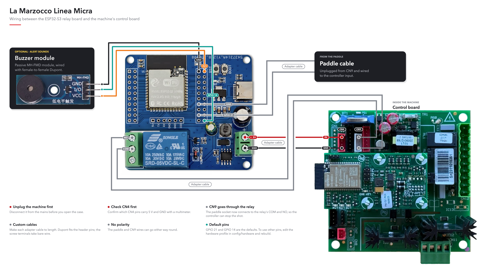
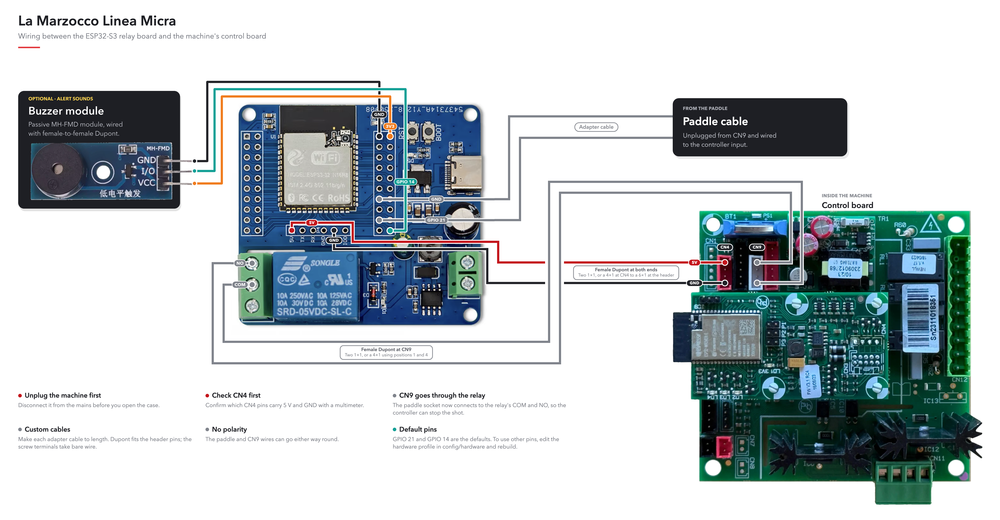
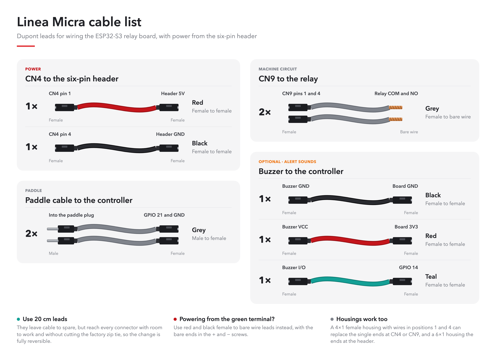
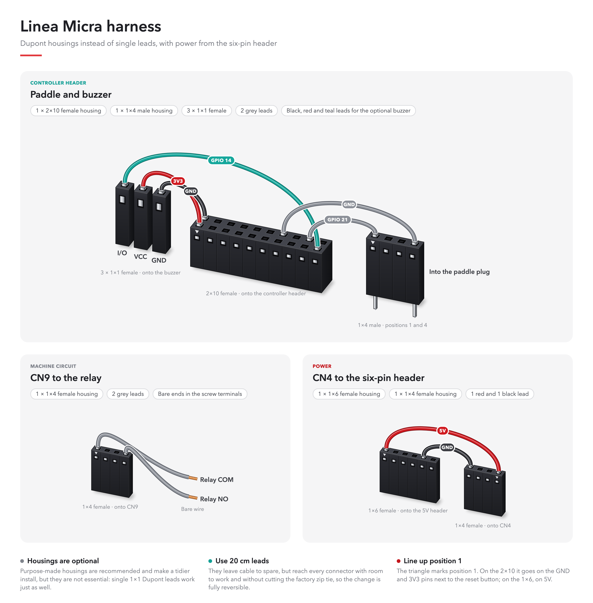

# Hardware

Development board used for this firmware, default GPIO map, and wiring
warnings.

## Installation readiness

The board pin map and enclosure are documented below, together with
reference wiring for the Linea Micra.

Treat the diagrams as references, and do not assume compatibility from a machine name. Before connecting a machine, obtain and verify its circuit documentation and complete the applicable [bench tests](MANUAL_TEST_PLAN.md). This page cannot replace complete electrical verification.

On the Linea Micra, the intercepted brew-switch connector is labelled **CN9**.
This firmware treats that contact as the **machine circuit** — the isolated
path that makes the machine run — not as a Micra-specific name. Other machines
intercept a different brew/run circuit with the same relay contract. Other guides call this the **machine circuit** so the term also applies to
non-Micra installations.

## Requirements

- **Board:** the current built-in hardware profiles use an ESP32-S3 N16R8
  (16 MB flash / 8 MB PSRAM). The [development relay board](#development-board)
  has a specific GPIO map; another board needs a complete reviewed profile.
- **Scale:** a supported Bluetooth model. Bookoo Themis Mini/Ultra were the
  primary development scales. Check the [model and capability table](../libraries/EspressoScaleBLE/README.md#scale-compatibility);
  implemented protocols are not all equally tested.
- **Machine:** a compatible activation circuit connected only to isolated relay
  contacts, plus a physical switch input appropriate to the selected build.
- **Installation skills:** identify and verify your machine's electrical
  connections, build the firmware, and test the installation on a bench.

The controller sits inside the machine in a
[printable enclosure](#3d-printable-enclosure), included in
standard and thick versions. Print it in PETG or a more heat-resistant
material, never PLA.
Classic ESP32, boards without PSRAM, and Timemore scales are outside the current
support scope.

## How it works

The controller reads your brew switch separately from the machine's activation
circuit. It can therefore interpret your gesture and stop brewing according to
the scale, recipe guards, or time limits.

On paddle machines, the relay remains closed while brewing and opens to stop.
On momentary machines, it copies button presses and sends a pulse to request a
stop. **Opening that relay alone does not necessarily stop a momentary machine.**
See [Machine types](#machine-types) before choosing a build.

## Machine types

Prefer a named [hardware and machine build profile](BUILD_PROFILES.md).
The selected machine profile resolves the corresponding compile-time type; it
is not a Web UI setting.

| Build | Value | How the controller knows the group is running |
| --- | ---: | --- |
| [Paddle / latch](settings/paddle.md) | 0, default | Follows the maintained brew contact. Developed first for the Linea Micra. |
| [Momentary](settings/momentary.md) | 1 | Infers flow from scale readings. Without confirmed flow, an automatic stop pulse may not be sent. |
| [Momentary + reed](settings/momentary.md) | 2 | Uses an additional reed/hall input to observe the machine state. Preferred for momentary installations. |

Support for a switch model is not certification of a particular espresso
machine. The firmware's 60 s relay limit and the ability to stop water flow
are different on momentary machines; read the [stop limitations](settings/momentary.md#stopping-and-time-limits).

## Parts checklist

| Part | Selection requirement |
| --- | --- |
| ESP32-S3 relay controller | Supported PSRAM variant; verify actual module, GPIO map and relay polarity against the board below. The development board ships its pin headers loose: solder them before wiring. |
| Printed enclosure | Required. Print it in PETG at least, never PLA; see [3D-printable enclosure](#3d-printable-enclosure). |
| Power source | Voltage, isolation, capacity, and protection verified for the actual board and machine. The repository does not define a universal machine power tap. |
| Wiring, connectors, mounting | Correct ratings, insulation, strain relief and clearance for the installation; machine-specific part numbers remain unverified. |
| Dupont leads (Linea Micra) | One [pack of 20 cm Dupont leads](https://www.aliexpress.com/item/1005006754560696.html), option **20cm 3kinds 120pcs** (female–female, male–male and male–female), has everything needed to connect the controller to the Micra with single 1×1 leads. See [Linea Micra cables](#linea-micra-cables). |
| Dupont housings (Linea Micra, optional) | One [2×10 housing](https://www.aliexpress.com/item/1005012190859135.html), plus one 1×6 and three 1×4 housings from an [assorted housing pack](https://www.aliexpress.com/item/1005012842619301.html). These listings are only examples. |
| Bluetooth scale | Check [model capabilities](../libraries/EspressoScaleBLE/README.md#scale-compatibility). |
| Reed/hall feedback | Recommended for momentary machines; input must be compatible with the ESP32 and isolated from the machine circuit. |
| Local sound | Optional passive buzzer; see [connection notes](#local-buzzer). |
| Independent safety barrier | A reviewed K2/heartbeat/feedback design where required; no universal K2 circuit is provided here. |
| USB data cable / console jumper | Used for installation and diagnostics; see [USB console jumper](#usb-console-jumper). |

The functional path is physical switch → ESP32 input → control policy →
isolated relay contacts → machine activation circuit. It is a signal-flow
description, not a wiring schematic. Paddle uses a maintained contact;
momentary uses press/stop pulses.

## Linea Micra wiring

The paddle cable, CN9 and the optional buzzer are wired the same way in both
layouts; they differ only in where the controller takes its power from CN4.

### Power from the green terminal



### Power from the six-pin header

CN4 supplies 5 V, the voltage the controller board itself runs on, so on the
Micra you can instead wire CN4 to the **5V** and **GND** pins of the board's
six-pin header and leave the green terminal empty. The header's 5V pin is the
board's own 5 V supply, so only connect it to a source you have measured at
5 V.



## Linea Micra cables

Use 20 cm Dupont leads: they reach every connector without cutting the
machine's factory zip tie, so you can undo the installation completely. Both
options below are for the six-pin header layout.

### Single Dupont leads

Every connection uses its own 1×1 lead. For the bare ends at the relay, cut
one end off a lead and strip it.



### Dupont housings (optional)

Grouping the same leads into multi-pin housings is recommended because it
makes a tidier install that is harder to plug in wrong, but it is not
essential: single 1×1 leads work just as well. Slide the single housings off
the leads and push their crimped ends into the larger housings, lining up
position 1 with the triangle.



## Development board

Firmware was developed on an **ESP32-S3 1-channel relay** board (WROOM-1
**N16R8** module: 16 MB flash, 8 MB OPI PSRAM, USB-C, onboard Songle relay
with COM / NO / NC screw terminals). Product listing used for development:
[ESP32-S3 1-channel relay (AliExpress)](https://es.aliexpress.com/item/1005011880181624.html).
Its pin headers come loose in the bag, so solder them to the board before
wiring. Unlike many ESP32 boards, it does not need its **BOOT** button held to
accept new firmware over USB.

### Front


### Back


Every ESP32-S3 Relay X1 covered by this project uses the **N16R8** module. The
named `esp32-s3-relay-x1-speaker` hardware profile is the authoritative GPIO,
relay, memory, and peripheral description for the speaker-equipped assembly;
it is not a generic DevKit pinout. Classic ESP32 and Arduino Nano ESP32
are not supported.

The firmware for these boards can use the error correction (ECC) built into
the module's PSRAM, its external working memory. The controller lives inside a
hot machine, and Espressif rates this memory for a higher ambient temperature
with ECC on. ECC sets aside a sixteenth of the PSRAM, which still leaves the
controller plenty of room. **Diagnostic → Flash and PSRAM → PSRAM ECC** shows
whether the installed firmware uses it. If the memory ever returns a faulty
value, the log shows a `PSRAM ECC detected` warning; see
[Troubleshooting](FAQ.md#safety-and-diagnostics).

## 3D-printable enclosure

The controller goes inside the machine in a two-part printed enclosure made for
the ESP32-S3 relay development board; every installation needs one. The STL
files are in [`stl/`](../stl/). Choose a matching box-and-cover pair:

- **Standard:** `OpenBrewByWeight-Box.stl` with its open/partial cover
  `OpenBrewByWeight-Cover.stl`.
- **Thick:** `OpenBrewByWeight-Box-thick.stl` with its thicker cover
  `OpenBrewByWeight-Cover-thick.stl`. This pair
  better resists deformation where the ESP32 is exposed to more heat.

The inside of an espresso machine gets hot, so never print the enclosure in
PLA. Use PETG at least; ABS, or a composite that resists warping under heat,
such as glass-fiber PETG, is better.

The supplied geometry is a fit reference, not a thermal or electrical safety
rating. Choose material and mounting for measured temperatures and required
clearances; a printed case does not establish suitability inside a hot machine.

Example of the assembled, printed enclosure:


Named wiring lives in `config/hardware/`; compile-time safety assertions remain
in `src/OpenBrewByWeightHardware.h`. Pins are **not**
editable from the Web UI.

## Default GPIOs

| Function | GPIO | Level |
| --- | ---: | --- |
| Activator (to GND) | **21** | Active **LOW** (internal pull-up; ON = GPIO LOW). Paddle or switch, depending on machine type. |
| Reed (momentary+reed builds) | **13** | Active **LOW** (internal pull-up; ON = GPIO LOW). Compile `OPEN_BREW_BY_WEIGHT_MACHINE_TYPE=2`. Override with `-DOPEN_BREW_BY_WEIGHT_REED_GPIO`. Must stay distinct from activator, relay, LED, buzzer, USB console, and safety GPIOs. |
| Onboard relay coil | **2** | Active **HIGH** (HIGH energizes the coil and closes NO) |
| Scale-connected LED | **1** | Active HIGH while a BLE scale is connected; fast blink while connecting, slow blink on a stale weight stream (switchable in Alerts) |
| Optional buzzer | **14** | Present on speaker builds (passive piezo, RTTTL); sounds are compiled in from the hardware profile. `-DOPEN_BREW_BY_WEIGHT_ENABLE_BUZZER=0` omits them. |
| USB console jumper | **4** | Active **LOW**. Dupont **IO4 → a GND pad you choose**. Sampled once at boot. **Do not** jumper IO4 to **EN** (that column is reset). Override with `-DOPEN_BREW_BY_WEIGHT_USB_CONSOLE_GPIO`. Must stay distinct from activator, relay, LED, buzzer, reed, and safety GPIOs. |

Optional external K2 safety (both pins or neither; no defaults, because they
depend on a reviewed board):

- `OPEN_BREW_BY_WEIGHT_SAFETY_HEARTBEAT_GPIO`
- `OPEN_BREW_BY_WEIGHT_CIRCUIT_FEEDBACK_GPIO`
- `OPEN_BREW_BY_WEIGHT_CIRCUIT_FEEDBACK_CLOSED_LEVEL` (optional; default LOW)

Compile example (GPIO overrides). Add
`-DOPEN_BREW_BY_WEIGHT_ENABLE_REMOTE_MACHINE_CONTROL=1` only for an explicit
opt-in remote-control development build; default firmware leaves start/rinse
on the physical activator:

```sh
./scripts/dev build --hardware esp32-s3-relay-x1-speaker \
  --machine la-marzocco-linea-micra \
  --flags "-DOPEN_BREW_BY_WEIGHT_SAFETY_HEARTBEAT_GPIO=16 -DOPEN_BREW_BY_WEIGHT_CIRCUIT_FEEDBACK_GPIO=17"
```

To use a different paddle, relay, LED, buzzer, or USB-console pin, add or edit
a reviewed hardware profile (or use the matching explicit `-D` override)
and rebuild. A profile must explicitly list every supported optional role;
absent hardware uses only `{ "present": false }` and has no fictitious GPIO.
Wrong pins can leave machine circuit closed or misread the paddle.

## USB console jumper

App USB CDC is **off** unless GPIO 4 is held LOW at reset (Dupont to GND),
or the firmware was compiled with `-DOPEN_BREW_BY_WEIGHT_ENABLE_JTAG=1`. Leave the
pin floating when the controller is inside the machine. Pull the Dupont
**before** installing.

- **With jumper at reset (default firmware):** `/dev/cu.usbmodem*` /
  `/dev/ttyACM*` appears; [USB serial CLI](SERIAL_CLI.md) and `monitor-idf`
  work.
- **JTAG build (`-DOPEN_BREW_BY_WEIGHT_ENABLE_JTAG=1`):** USB Serial/JTAG is on at
  boot (OpenOCD + CDC) with no jumper. Do not ship this to a machine build.
- **Without jumper, default app running:** no CDC port. Flash with
  **BOOT + RST** (ROM USB download).
- ROM download always works, jumper or not. On this board IO4 sits next to
  **EN** — never short that pair.

## Isolation (must)

- The machine circuit connects only to the relay **COM/NO** contact. Never to GND, VCC, or an
  ESP32 GPIO.
- Do not use NC as the brew path.
- Feedback, if you add it, must also be isolated. Do not join machine circuit ground to
  ESP32 ground.
- The onboard relay is **not** a certified safety barrier. A welded contact
  or a shorted driver needs a second, normally-open contact (K2) driven by an
  independent heartbeat. Without that, protection is software-only.

Verify continuity, module polarity, and that the relay stays **open** during
startup, reset, and power loss.

## Scale-connected LED

GPIO 1 is HIGH while a BLE scale is connected and **Settings → Shared settings → Alerts → Blue
LED while scale connected** is on. It blinks fast while a scale connects and
slowly when a connected scale stops sending weight. It is diagnostic only and
is never part of the machine-circuit decision.

Override at compile time with `-DOPEN_BREW_BY_WEIGHT_SCALE_CONNECTED_LED_GPIO=…`.
The pin must be output-capable and distinct from paddle, relay, buzzer,
heartbeat, and feedback.

## Local buzzer

Wire a **passive** 3.3 V piezo/speaker to `OPEN_BREW_BY_WEIGHT_BUZZER_GPIO` (default
14). The firmware drives it with PWM (RTTTL melodies), so it must be
**passive, not active**. A module with three pins — **GND**, **VCC** and
**IN** — is preferred over a loose two-wire speaker: connect GND to GND, VCC
to 3.3 V, and IN to the buzzer GPIO. For a two-wire passive piezo, connect
the marked **+** to the GPIO and the other lead to GND.

While silent, the firmware holds the buzzer GPIO at the level that switches
the buzzer off, so it does not pick up electrical noise. That level depends on
the transistor on the module, set by `speaker.active_level` in the hardware
profile:

| Buzzer | Transistor | `active_level` |
|---|---|---|
| 3-pin module that sounds on a low input (the example below) | S8550 / 9012 (PNP) | `low` (default) |
| 3-pin module that sounds on a high input | S8050 / 9013 (NPN) | `high` |
| Two-wire passive piezo on the GPIO | none | `high` |

A wrong setting still plays sounds, but leaves the buzzer switched on while
silent, which brings back the noise and wastes power. Do not wire a magnetic
two-wire buzzer straight to the GPIO; use a module with a transistor.

Example used: [3.3 V passive buzzer module (AliExpress)](https://es.aliexpress.com/item/1005007287329656.html).

`-DOPEN_BREW_BY_WEIGHT_ENABLE_BUZZER=0` omits the driver. See [Alerts](alerts.md) and
[Build environment](BUILD.md).

## Additional hardware used

### Reed switch (optional, strongly recommended for momentary machines)

The reed switch is optional, but is strongly recommended for momentary-button
machines such as the **Rancilio Silvia Pro X**. Without it, firmware combines
its internal state machine with scale readings to infer whether the machine is
running. With a reed switch on the solenoid, it reads the machine state
directly, which is substantially more reliable and precise.

Use it with the momentary+reed build (`OPEN_BREW_BY_WEIGHT_MACHINE_TYPE=2`); the
default input is GPIO 13, as documented in [Default GPIOs](#default-gpios).
It is generally unnecessary for latch/paddle machines such as the **Linea
Micra**.

Example used: [reed switch sensor module (AliExpress)](https://es.aliexpress.com/item/1005002797173105.html).

Related: [Disclaimer](../DISCLAIMER.md), [FAQ](FAQ.md).
