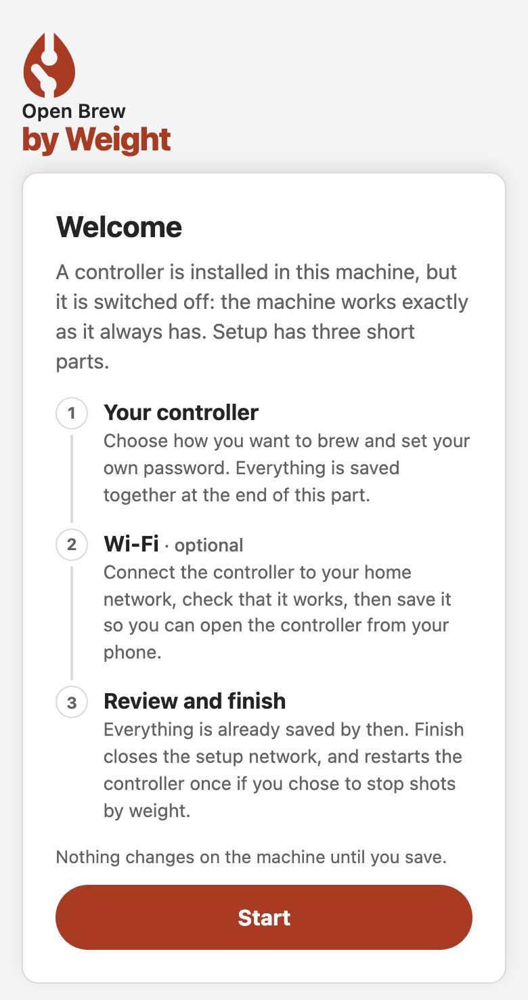
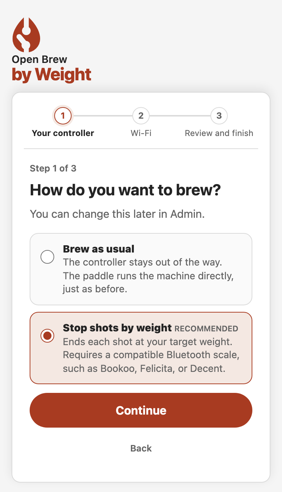
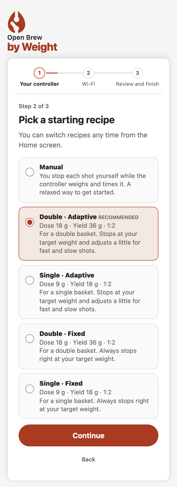
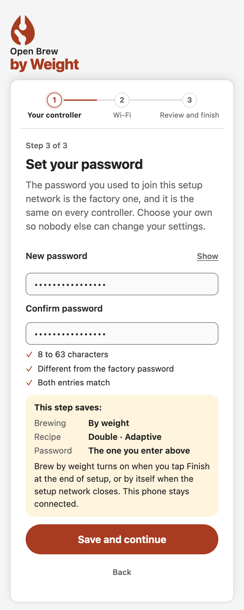
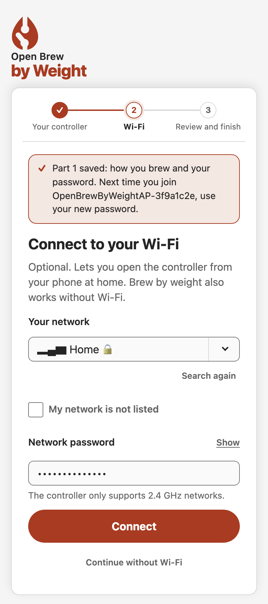
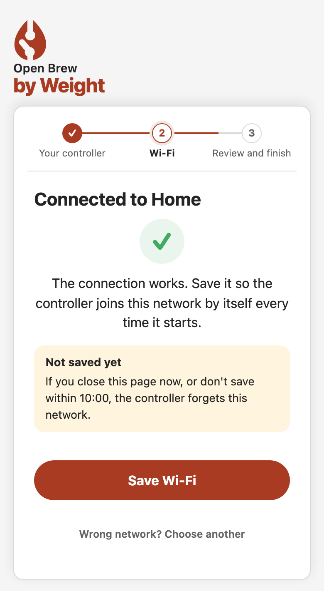
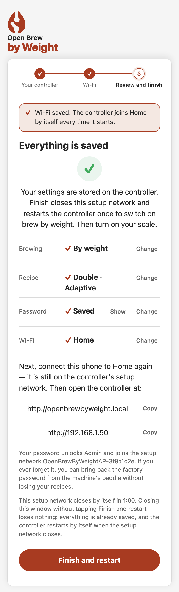
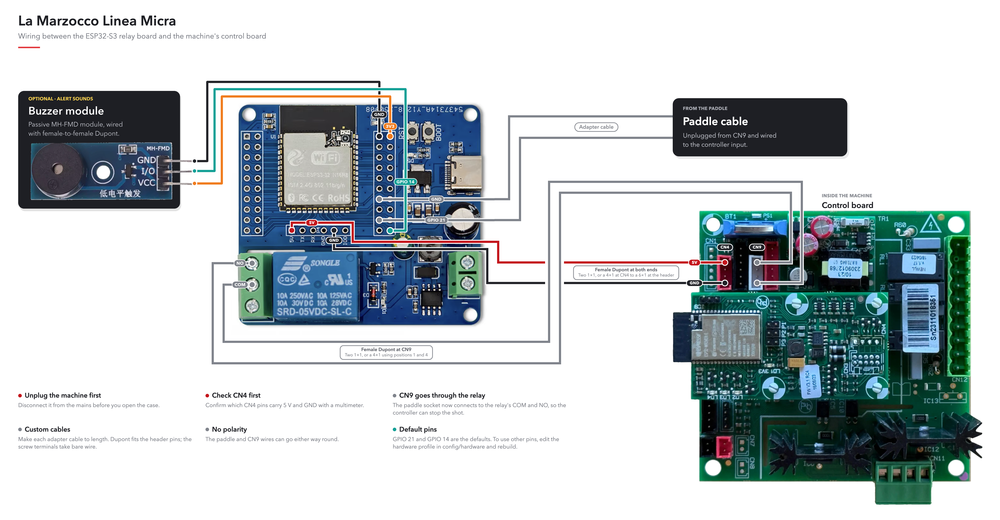
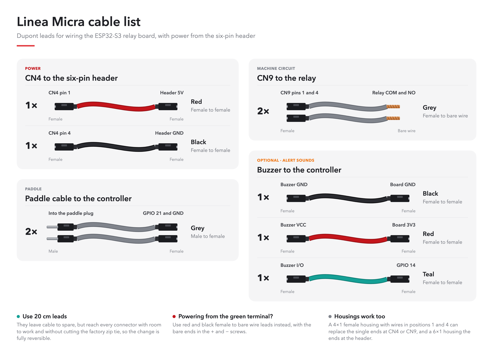

# Quickstart

The shortest path for the reference build: an ESP32-S3 Relay X1 controller on
a La Marzocco Linea Micra. You install and set up the controller on the bench
first, with nothing connected to the machine; wiring it in comes last. Each
step links to its full guide. Other machines follow the same path with their
own [build profile](BUILD_PROFILES.md) and wiring.

## 1. Get the parts

| Part | Qty | Reference price (USD) | Notes |
| --- | ---: | ---: | --- |
| [ESP32-S3 1-channel relay board](HARDWARE.md#development-board), N16R8 | 1 | 15–23 | Must be the N16R8 module (16 MB flash, 8 MB PSRAM). The pin headers come loose in the bag: solder them to the board before wiring. |
| [20 cm Dupont lead pack](HARDWARE.md#linea-micra-cables), "20cm 3kinds 120pcs" | 1 | 3 | Every lead the Micra needs. |
| Supported [Bluetooth scale](../libraries/EspressoScaleBLE/README.md#scale-compatibility) | 1 | 130–150 | Bookoo Themis Mini shown; other models cost more or less. |
| USB-C data cable | 1 | 3 | Charge-only cables cannot install firmware. |
| [Passive 3.3 V buzzer module](HARDWARE.md#local-buzzer) (optional) | 1 | 1–4 | Alert sounds. Must be passive. |
| [Dupont housings](HARDWARE.md#dupont-housings-optional) (optional) | 1 set | 8 | A tidier harness that is harder to plug in wrong. |
| [Printed enclosure](HARDWARE.md#3d-printable-enclosure) | 1 | 1–2 | Filament only: PETG or better. See step 4. |

Without the scale, the required parts cost about US$22–31. Prices are a
November 2026 reference from AliExpress, before shipping and taxes, and change
often.

You also need a soldering iron, a multimeter, a wire stripper and a small
screwdriver.

## 2. Build and install the firmware

On macOS (Ubuntu packages are in the [build guide](BUILD.md#linux)):

```sh
brew install git python cmake ninja cjson node cppcheck ccache

# ESP-IDF 6.1; the project scripts find it here on their own
git clone -b v6.1 --recursive https://github.com/espressif/esp-idf.git ~/esp/esp-idf-v6.1
~/esp/esp-idf-v6.1/install.sh esp32s3

git clone https://github.com/Cheerpipe/Open-Brew-by-Weight.git
cd Open-Brew-by-Weight
git checkout "$(git describe --tags --abbrev=0)"   # latest release
npm ci
./scripts/dev doctor
```

Connect only the board by USB, then build and install. The script finds the
board and asks you to confirm its port: press Enter. If it finds none, try
another USB cable: many only charge. Many ESP32 boards need their **BOOT**
button held to accept new firmware; the Relay X1 does not.

```sh
./scripts/dev build flash --confirm --erase-all \
  --hardware esp32-s3-relay-x1-speaker \
  --machine la-marzocco-linea-micra
```

`--erase-all` is for the first installation on a new board: it wipes the whole
flash. Later updates install over Wi-Fi ([OTA](features/ota.md)) and keep
your settings.

## 3. Connect it to your Wi-Fi

Do this on the bench, with the controller powered over USB.

1. On your phone, join the **`OpenBrewByWeightAP-…`** network. The password is
   `ineedacoffee`. Stay joined even if the phone says there is no internet.
2. The setup page opens on its own within a few seconds. If it does not, open
   **`http://192.168.4.1/setup`**.
3. Choose how you want to brew and a starting recipe, then pick your own
   password. It replaces `ineedacoffee` and is the one you use to sign in from
   now on.
4. Choose your home network, type its password and select **Connect**. When the
   page confirms the controller got in, select **Save Wi-Fi**.
5. Select **Finish**, switch your phone back to your home network and open
   **`http://openbrewbyweight.local`**, or the address the setup page showed.

These are the screens you go through on your phone. The example network is
called Home; yours shows your own network and address.

<table>
<tr>
<td width="33%" valign="top"><b>1. Welcome.</b> The page lists the three parts. Select <b>Start</b>.<br><br>
<picture><source media="(prefers-color-scheme: dark)" srcset="images/onboarding-1-welcome-dark.png"></picture></td>
<td width="33%" valign="top"><b>2. How you brew.</b> Keep brewing as usual, or stop shots by weight.<br><br>
<picture><source media="(prefers-color-scheme: dark)" srcset="images/onboarding-2-mode-dark.png"></picture></td>
<td width="33%" valign="top"><b>3. Starting recipe.</b> Shown when you stop shots by weight. You can switch recipes any time from the Home screen.<br><br>
<picture><source media="(prefers-color-scheme: dark)" srcset="images/onboarding-3-recipe-dark.png"></picture></td>
</tr>
<tr>
<td width="33%" valign="top"><b>4. Your password.</b> Type it twice. <b>Save and continue</b> stores everything in this part.<br><br>
<picture><source media="(prefers-color-scheme: dark)" srcset="images/onboarding-4-password-dark.png"></picture></td>
<td width="33%" valign="top"><b>5. Wi-Fi.</b> Choose your network, type its password and select <b>Connect</b>. Only 2.4 GHz networks work.<br><br>
<picture><source media="(prefers-color-scheme: dark)" srcset="images/onboarding-5-wifi-dark.png"></picture></td>
<td width="33%" valign="top"><b>6. Connected.</b> The connection works but is not saved yet: select <b>Save Wi-Fi</b>.<br><br>
<picture><source media="(prefers-color-scheme: dark)" srcset="images/onboarding-6-connected-dark.png"></picture></td>
</tr>
<tr>
<td width="33%" valign="top"><b>7. Review and finish.</b> Everything is saved. Note the address, rejoin your home network and select <b>Finish</b>.<br><br>
<picture><source media="(prefers-color-scheme: dark)" srcset="images/onboarding-7-summary-dark.png"></picture></td>
</tr>
</table>

[First setup](GETTING_STARTED.md#connect-for-the-first-time) explains every
choice on these screens in detail.

## 4. Print the enclosure

The controller goes inside the machine in its printed enclosure. Print one
box-and-cover pair from [`stl/`](../stl/):

- **Standard:** [`OpenBrewByWeight-Box.stl`](../stl/OpenBrewByWeight-Box.stl) and
  [`OpenBrewByWeight-Cover.stl`](../stl/OpenBrewByWeight-Cover.stl).
- **Thick:** [`OpenBrewByWeight-Box-thick.stl`](../stl/OpenBrewByWeight-Box-thick.stl)
  and [`OpenBrewByWeight-Cover-thick.stl`](../stl/OpenBrewByWeight-Cover-thick.stl).
  It holds its shape better where the controller gets hotter.

The inside of an espresso machine gets hot, so never print the enclosure in
PLA. Use PETG at least; ABS, or a composite that resists warping under heat,
such as glass-fiber PETG, is better. The enclosure is a fit reference, not a
heat or electrical rating: see [3D-printable enclosure](HARDWARE.md#3d-printable-enclosure).

## 5. Wire it into the Micra

Unplug the machine from the mains first. Measure which CN4 pins carry 5 V and
GND before connecting anything, and connect CN9 only to the relay's **COM** and
**NO** terminals.



<details>
<summary>Cable list: which Dupont lead goes where</summary>



</details>

Powering from the green terminal instead, or building a harness with housings?
See [Linea Micra wiring](HARDWARE.md#linea-micra-wiring).

## 6. Pull the first shot

Connect the scale, choose a recipe and brew: see
[First shot](GETTING_STARTED.md#first-shot).
